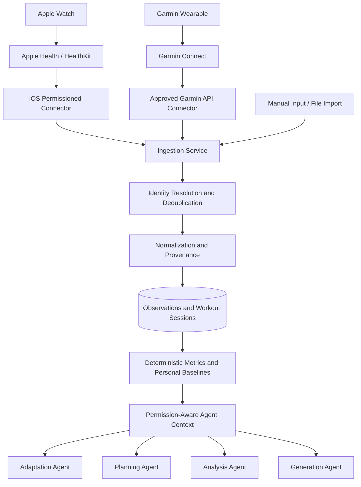

# Health & Wearable Data Integration — Concept and Architecture

**Standalone product and technical concept · Version 1.0 · October 2026**

## Executive Summary

This document defines the health and wearable data layer for a multi-sport workout platform covering CrossFit, triathlon (swimming, cycling, running), yoga, and HIIT. It can be used independently from the separate workout-agent architecture document.

The integration is optional and designed to import training activities and permissioned wellness metrics from Apple Watch via Apple Health/HealthKit and Garmin via approved Garmin Connect integrations. Data feeds into normalized observations, completed workout sessions, deterministic metrics and athlete-specific baselines. AI-powered workout import, adaptation, generation, planning and analysis consume only authorized, purpose-specific context.

**Architectural boundary:** wearable connectors collect data; deterministic services clean and analyze it; AI agents interpret and propose actions. Health-informed modifications to workouts and schedules require user review and approval. This is a fitness and wellness product, not a medical device or diagnosis service.

## Relationship to Workout and AI Modules

The platform already has concepts of `Workout`, `WorkoutBlock`, `WorkoutStep`, `Exercise`, `WorkoutSession`, `AthleteProfile` and `TrainingPlan`. This health module adds wearable connections, devices, physiological observations, activity reconciliation, personal baselines and permissioned agent context. Other modules can integrate through stable APIs rather than embedding provider-specific logic.

## 1. Objectives and Product Scope

**Goal:** Add opt-in physiological, wellness, activity, and workout telemetry to the existing universal workout model without turning the product into a medical diagnosis system.

The wearable layer should:

1. Import historic and newly recorded workouts and health observations, with provenance.
2. Link observed workout performance to the planned workout and its blocks where feasible.
3. Maintain athlete-specific trends and baselines rather than compare everyone with one fixed threshold.
4. Support explainable suggestions by the existing Adaptation, Planning, and Analysis agents.
5. Remain usable when the athlete declines permission, lacks a wearable, or supplies only partial measurements.
6. Keep measured values, vendor-calculated estimates, and app-derived metrics clearly distinguishable.

**Scope:** Fitness and wellness support, not medical screening, diagnosis, treatment, or emergency monitoring. Physiological data should inform cautious recommendations, not trigger definitive medical claims.

### 1.1 Integration paths

| Ecosystem | Proposed entry point | Data movement | Key limitation |
|---|---|---|---|
| Apple Watch / Apple Health | iOS app using Apple HealthKit | Permissioned on-device read; app syncs authorized data to backend if opted in | No general server-side HealthKit API; availability and authorized history vary by data type and user |
| Garmin | Garmin Connect Developer Program (Health and Activity APIs) | Authorized cloud integration, potentially event-driven updates after device sync | Requires program access/approval and permitted scopes; availability depends on partner terms and device |
| Garmin workout publishing (later) | Garmin Training API | Publish supported structured workouts to compatible devices | Separate integration concern from reading completed activities |
| Files / manual fallback | FIT/TCX/GPX/CSV or manually entered values, subject to implemented parsers | User-uploaded import with source tracking | Not all formats include the same wellness data; GPX alone generally does not contain all physiology |

Do **not** assume Garmin's proprietary scores (e.g., Body Battery, training readiness) or Apple-presented summary features are available as interchangeable fields through every integration. Model provider-specific availability explicitly and offer raw-metric fallbacks.

## 2. Health Data Catalog and Semantics

Each metric has a canonical internal key, unit, origin, time range, source, and quality descriptor. Store both original and normalized values where legally and technically appropriate.

| Category | Canonical metrics / observations | Typical use |
|---|---|---|
| Heart | `heart_rate_bpm`, `resting_hr_bpm`, `hrv_ms` (include methodology), optional `heart_rate_recovery_bpm` | Session zones, longitudinal baseline changes, recovery context |
| Sleep | `sleep_duration_min`, `sleep_start/end`, `sleep_stage`, `sleep_consistency`, provider sleep score if available | Planning constraints and contextual insights |
| Recovery / wellness | `stress_score`, vendor readiness / recovery scores where licensed and available, `subjective_fatigue`, `subjective_soreness` | Non-diagnostic readiness context |
| Activity | `steps`, `active_energy_kcal`, `total_energy_kcal`, `active_minutes`, `distance_m`, `elevation_gain_m` | Daily activity, workload, energy expenditure estimates |
| Endurance performance | `pace_sec_per_km`, `speed_mps`, `cycling_power_w`, `cadence_rpm`, `swim_pace_sec_per_100m`, `gps_track` | Discipline-specific analysis and prescribed intensity |
| Cardiorespiratory estimates | `vo2max_estimate`, lactate-threshold estimates if available, `respiratory_rate` | Trend monitoring with model/device caveats |
| Workout telemetry | `workout_type`, `start/end`, `moving_duration_s`, `elapsed_duration_s`, `heart_rate_series`, `power_series`, `lap/split`, route | Match and reconcile completed sessions |
| Context | user-entered `rpe`, mood, perceived recovery, optional weight | Explain performance and allow training decisions without a wearable |

**Important distinctions:**

- HRV measurements are not universally comparable: sampling conditions and algorithms differ. Store the vendor metric, unit, measurement method (e.g., SDNN vs RMSSD if known), and sampling window; avoid merging incompatible HRV methodologies into one trend.
- Calorie expenditure, VO₂max, sleep-stage labels, training load, and readiness scores are estimates, not direct physiological ground truth.
- A missing metric means **missing or inaccessible**, not zero, healthy, or unhealthy.
- The presence of a wearable does not guarantee a particular metric, cadence, history depth, or resolution.
- Female health, medical records, ECG, oxygen saturation, and similar more sensitive categories should not be imported by default; assess each separately for necessity, availability, policy restrictions, and explicit consent.

### 2.1 Normalized data example

```json
{
  "observation_id": "obs_001",
  "athlete_id": "athlete_123",
  "metric": "resting_hr_bpm",
  "value": 54,
  "unit": "bpm",
  "observed_at": "2026-10-12T07:00:00+02:00",
  "source": {
    "provider": "apple_health",
    "device_type": "apple_watch",
    "external_id": "sample_opaque_123",
    "source_app": "com.example.source"
  },
  "origin": "device_estimate",
  "quality": {
    "status": "available",
    "confidence_note": "Provider-supplied estimate; context may vary"
  },
  "ingested_at": "2026-10-12T07:05:00+02:00"
}
```

This is an **illustrative internal format**, not a claim about an exact Garmin or HealthKit JSON payload.

## 3. Wearable Integration and Data Pipeline



### 3.1 Connector workflow

1. Display a clear reason for each requested data category before authorization.
2. Complete platform-native permission or provider authorization; allow revocation.
3. Ingest historical data within the authorized window, then incrementally synchronize new/updated records.
4. Convert provider-specific fields to canonical observation or activity schemas without discarding provenance.
5. Deduplicate events and workouts that appear in multiple sources (e.g., Garmin activity also synchronized into Apple Health).
6. Recompute affected summaries and athlete baselines when data is created, updated, or deleted.
7. Make data available to agents only through restricted, purpose-specific tools.
8. Provide an explicit user disconnect, retention, and deletion path, including appropriate cleanup of derived insights.

### 3.2 Idempotency and duplicate handling

- Prefer stable `(provider, external_record_id, record_version)` identifiers when the provider supplies them.
- Where the same session occurs in different providers, use candidate matching on timestamp, activity type, duration, and distance, **not** blind automatic merging.
- Preserve source record IDs and audit decisions; select an authoritative value per metric rather than arbitrarily averaging sensor data.
- Retain timezone-aware timestamps, UTC storage, and clear local-day grouping for sleep and daily summaries.
- Treat deletions, permission changes, late device syncs, revised scores, and replays as normal events.

## 4. New Data Entities and Relationships

| Entity | Purpose | Important fields |
|---|---|---|
| `WearableConnection` | Authorization and sync lifecycle | athlete, provider, scope metadata, status, last sync; encrypted credentials in secret store |
| `Device` | Identify source hardware | provider device ID, device model if known, firmware if provided |
| `HealthObservation` | Timestamped normalized measurement | metric, value, unit, observed time/window, provenance, quality |
| `HealthSeries` | High-frequency telemetry or reference to series storage | metric, sampling interval, range, source activity, storage reference |
| `DailyHealthSummary` | Reproducible daily rollup | day, timezone, activity, sleep, baseline-relative metrics, calculation version |
| `AthleteBaseline` | Personal normal range | metric, method, minimum samples, rolling window, version |
| `ExternalActivity` | Original imported activity | provider activity ID, discipline, start/end, summary, raw reference |
| `SessionMatch` | Link imported activities to planned or completed sessions | `workout_session_id`, external activity ID, match status, confidence and review state |
| `HealthInsight` | Explainable agent insight | evidence IDs, timeframe, calculation version, recommendation, user disposition |
| `ConsentRecord` | Document permissions and purposes | categories, timestamps, permitted purpose, revocation and retention status |

### 4.1 Sample athlete daily summary

```json
{
  "athlete_id": "athlete_123",
  "date": "2026-10-12",
  "timezone": "Europe/Berlin",
  "sleep": {"duration_minutes": 415, "source": "apple_health"},
  "heart": {"resting_hr_bpm": 57, "source": "apple_health"},
  "recovery_context": {
    "resting_hr_vs_baseline_bpm": 4,
    "baseline_status": "sufficient_samples",
    "missing_metrics": ["comparable_hrv"]
  },
  "activity": {"steps": 6830},
  "data_quality": {"is_partial": true},
  "calculation_version": "daily_summary_v1"
}
```

Numbers are synthetic. Do not interpret this example as proof of fatigue or illness.

## 5. Changes to Each Existing Agent

### 5.1 Workout Import Agent — Wearable-aware workout matching

**New functions:** Ingest externally completed activities as candidate workout sessions; identify sport, GPS/lap/power/heart-rate metadata; link the activity to an existing planned workout when supported by evidence.

**Tools:** `listExternalActivities`, `getExternalActivity`, `findSessionCandidates`, `suggestSessionMatch`, `createCompletedSessionDraft`.

**Guardrail:** An imported activity is not automatically equivalent to the planned prescription. Keep planned vs actual fields distinct. Require confirmation for ambiguous session matches.

### 5.2 Workout Adaptation Agent — Recovery-informed adjustments

**New functions:** Combine the user's requested adjustments with recent workload, sleep trends, baseline-relative resting HR/HRV, and subjective fatigue if available. Offer modifications to intensity, volume, and structure.

**Example:** "My usual sleep has been shorter, resting heart rate is above my own baseline, and I feel tired. Suggest a lower-load alternative to today's intervals."

**Tools:** `getRecentHealthContext`, `getPersonalBaselines`, `getWorkloadSummary`, existing adaptation and validation tools.

**Guardrail:** Never treat one abnormal wearable value as a medical diagnosis, and never silently modify a prescribed training plan. Explain evidence, uncertainty, and user override.

### 5.3 Workout Generation Agent — Physiology-aware prescriptions

**New functions:** Use authorized fitness reference values (e.g., measured or user-confirmed FTP, valid running pace zones, maximum HR settings) to create feasible relative intensity targets.

**Tools:** `getAvailableFitnessReferences`, `getAthleteTrainingZones`, `getRecentLoad`, existing generation tools.

**Guardrail:** Reference values must carry source and freshness. If reference data are unavailable or questionable, ask for relevant values or use RPE/talk-test intensity rather than inventing personalized thresholds.

### 5.4 Training Planning Agent — Load and recovery context

**New functions:** Review historical training volume by discipline, completed vs skipped sessions, total weekly load, and recovery context when considering a plan draft or rescheduling.

**Tools:** `getTrainingHistory`, `getWorkloadTrend`, `getRecoveryContext`, `getCalendarAvailability`, `createTrainingPlanDraft`.

**Guardrail:** Trend shifts are decision support, not clinical rules. Avoid escalating training intensity solely because a vendor readiness score is high; use explicit user confirmation for meaningful plan changes.

### 5.5 Workout Analysis Agent — Performance and recovery insights

**New functions:** Compare pace, power, HR, duration, elevation, RPE, training frequency, and relative recovery metrics over appropriate comparable conditions.

**Example insight:** "At comparable pace on similarly flat runs, your observed heart rate was lower in the last month; however, temperature and sensor differences are not accounted for."

**Tools:** `calculateTrend`, `compareSimilarSessions`, `getDailySummaries`, `getEvidenceRecords`, `createInsightDraft`.

**Guardrail:** Cite underlying time ranges, sample counts, and source records in the app; avoid causal claims without supporting data. Compare like with like.

### 5.6 Workout Validation Service — Wearable data quality rules

**New validations:**

- Valid units, ranges, timestamps, and interval ordering.
- No negative durations or physically nonsensical measurements.
- HRV method and sampling conditions compatible before cross-device comparisons.
- Provider fields and score meanings are tagged and not falsely normalized.
- Missingness, time zone, duplicate source records, and delayed sync detected.
- Only authorized metrics made available to each agent.
- Every health-derived suggestion carries traceable inputs and deterministic calculations where appropriate.

## 6. New Supporting Services (Not Autonomous Agents)

### 6.1 Health Data Sync Service

Manages source connections, backfill, provider events/polling where permitted, retry with backoff, updates/deletions, and sync observability.

### 6.2 Health Metrics and Personal Baseline Engine

Computes workout metrics, rolling baselines, daily summaries, and data completeness through versioned deterministic logic. Personal baselines should specify eligibility criteria and minimum sample counts, and must avoid treating sparse data as a trustworthy trend.

### 6.3 Workout-to-Activity Reconciliation Service

Suggests matches between planned workouts, user-recorded app sessions, and wearable activities; detects likely duplicates and retains user review for ambiguity.

### 6.4 Consent and Privacy Enforcement Service

Enforces source permissions, purpose-specific access, retention periods, revocation, export, deletion, and audit trails. Keep tokens encrypted and separated from agent prompts.

## 7. Privacy, Security, and Responsible AI

Health and biometric observations are sensitive personal data. For an EU-facing platform, perform a GDPR-oriented legal and privacy review before production rollout; the specific lawful basis, special-category conditions, retention and consent UX require professional review.

Required design practices:

- **Opt-in and minimization:** Request only metrics relevant to a visible feature, and allow the core workout app to operate without wearables.
- **Explicit purposes:** Separate operational sync permissions from any permission to use data for AI-based personalization; platform consent and GDPR lawful basis are not automatically identical.
- **Provider compliance:** Confirm Apple HealthKit rules, Garmin developer agreements, distribution and security obligations; do not assume unrestricted onward transfers or AI processing.
- **No unauthorized sharing:** Never put raw health data into logs, marketing pipelines, analytics SDKs, or model training without the applicable authorization and legal basis.
- **Secure processing:** Encrypt at rest and in transit, apply least-privilege access, tenant isolation, audit logs, secrets management, and deletion procedures.
- **Data lifecycle:** Retain source IDs, support user export and deletion, propagate eligible upstream deletions to derived summaries/insights, and specify storage periods.
- **Human control:** Display evidence and a confirm/edit action before workout or schedule modifications; avoid autonomous high-impact decisions.
- **No diagnosis:** Do not infer disease, offer medical clearance, or present estimates as medical measurements; show supportive guidance and suggest professional assessment when appropriate.
- **Avoid false precision:** Use labels such as "estimated", "device-reported", "insufficient data", and "not comparable".

## 8. MVP Implementation and Acceptance Criteria

### Phase A — Apple Health foundational integration (if an iOS app is planned)

- Implement HealthKit entitlement and purpose-specific authorization for workouts, workout heart rate, running/cycling distance and, optionally, sleep and resting HR.
- Import authorized samples/activities with durable provenance and deduplication.
- Map completed workouts to `WorkoutSession` drafts with manual confirmation on ambiguous matches.
- Show a basic athlete overview: last completed workouts, duration, HR and activity trends, and missing data states.

### Phase B — Garmin integration, subject to developer access

- Apply for and validate the necessary Garmin Connect Developer Program permissions and agreements.
- Integrate Health/Activity APIs and available update mechanisms; implement source-specific normalization.
- Test duplicate activity reconciliation for users who sync Garmin into another health ecosystem.

### Phase C — Agent context and personalization

- Add `getRecentHealthContext` and `getPersonalBaselines` tools with per-purpose permission checks.
- Extend Adaptation and Analysis first; enable explicit, reviewable workout change suggestions.
- Only later use longitudinal metrics for Planning and Generation once baseline validity is established.

### Example acceptance tests

1. A user who denies sleep permission can still import and execute workouts; the app marks sleep as unavailable.
2. One Garmin workout appearing via both Garmin and Apple Health does not count twice without an explicit reconciliation decision.
3. If an HRV metric uses an incompatible method, the agent does not combine it into one baseline.
4. Deleting a health-data connection prevents further ingestion and triggers the documented data retention/deletion workflow.
5. An adaptation suggestion reports which metrics and dates informed it, and waits for explicit approval.
6. A training plan never changes solely due to a single device-estimated readiness score.
7. Late synchronization corrects daily summary calculations without creating duplicate sessions.

### Success metrics

- Percentage of connected users with successful recent sync.
- Import latency after upstream data become available (per source, not assumed real time).
- Duplicated session rate and session-match correction rate.
- Percentage of summaries with sufficient, compatible baseline data.
- User acceptance/rejection and edit rate for health-informed suggestions.
- Percentage of insight claims linked to visible evidence and calculation versions.
- Incident-free handling of consent changes and deletions.

## 9. Product Boundary and Future Options

For initial release, prioritize **workout recording and contextual wellness insights**. Do not make medical inference, around-the-clock surveillance, or automatic health-based interventions part of the MVP.

Potential later extensions: supported workout push to Garmin devices, watchOS workout execution, optional live workout telemetry, athlete-defined HR/power zones, integration with additional wearable providers, and explicit in-app user feedback on recommended changes.

## 10. Official Integration References

These links are **documentation entry points**, not promises that each field or vendor score is exposed to every app or account. Validate the exact API contract and eligibility before implementation.

- [Apple — HealthKit overview](https://developer.apple.com/documentation/healthkit)
- [Apple — Authorizing access to health data](https://developer.apple.com/documentation/healthkit/authorizing-access-to-health-data)
- [Apple — Configuring HealthKit access](https://developer.apple.com/documentation/xcode/configuring-healthkit-access)
- [Garmin — Connect Developer Program](https://developerportal.garmin.com/developer-programs/connect-developer-api)
- [Garmin — Health ecosystem](https://www.garmin.com/en-US/health/ecosystem/)

---

**Updated architecture summary:** Workout Core + Wearable Connectors + Health Observations + Deterministic Metrics/Baselines + Permission-Aware AI Workflows + User Review. Device data are additional context, not a replacement for athlete goals, subjective feedback, or validated training logic.
