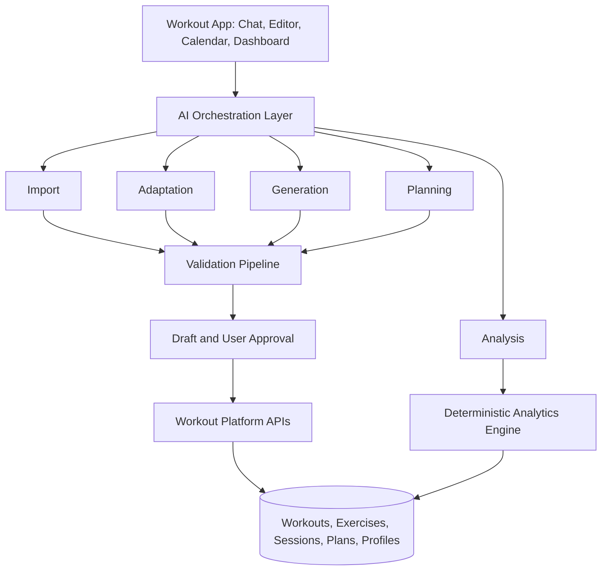

# AI Agent Concepts for a Workout Platform

**Product and Technical Concept · Version 1.0**

## 1. Vision and Scope

The platform supports CrossFit, triathlon (including swimming, cycling, and running individually), yoga, and HIIT. Built on a universal workout data model, AI capabilities help users import, adapt, generate, plan, and analyze workouts. A validation service ensures that generated or imported data conforms to the platform's schema and rules.

The six logical components are:

1. **Workout Import Agent** — converts unstructured workout descriptions into structured workout drafts.
2. **Workout Adaptation Agent** — adjusts existing workouts for available equipment, time, ability, or preferences.
3. **Workout Generation Agent** — creates new workouts from goals and constraints.
4. **Training Planning Agent** — designs and updates multi-day or multi-week training plans.
5. **Workout Analysis Agent** — interprets completed-session data and performance trends.
6. **Workout Validation Service / Semantic Review Agent** — verifies data integrity and flags potentially inconsistent or implausible content.

**Architectural recommendation:** Treat these as separate capabilities, not necessarily six autonomous, always-running agents. Initially, implement a shared agent service with isolated workflows and tool permissions. Use deterministic program logic wherever possible, especially for timers, calculations, schema checks, and persistence.

## 2. Shared System Architecture



### Shared entities

| Entity | Purpose |
|---|---|
| `Workout` | Defined workout and its metadata |
| `WorkoutBlock` | A workout section with a specific training format |
| `WorkoutStep` | Exercise, activity, rest, or transition within a block |
| `Exercise` | Canonical entry in the activity/exercise catalog |
| `WorkoutTemplate` | Reusable workout definition |
| `WorkoutVariant` | Adapted version of a workout |
| `WorkoutSession` | Completed instance and actual results |
| `AthleteProfile` | Authorized training preferences, capacities, and constraints |
| `TrainingPlan` | Scheduled multi-session program |
| `TrainingMetric` | Computed performance metric |
| `AgentExecution` | Auditable record of a workflow invocation |

The common schema should distinguish **sport**, **training purpose**, **execution format**, **planned prescription**, and **actual results**. Key formats include `for_time`, `amrap`, `repeating_interval`, `sets_reps`, `continuous`, and `sequence`. Support nested groups, multiple blocks, and multisport transitions.

### Shared agent request contract

```json
{
  "request_id": "req_123",
  "agent_type": "workout_import",
  "athlete_id": "athlete_123",
  "input": {
    "type": "text",
    "content": "12 min AMRAP: 10 Burpees"
  },
  "context": {
    "workout_schema_version": "1.0"
  }
}
```

### Shared agent response contract

```json
{
  "request_id": "req_123",
  "status": "requires_approval",
  "result": { "draft_id": "draft_456" },
  "validation": {
    "valid": true,
    "errors": [],
    "warnings": []
  },
  "requires_user_approval": true
}
```

Larger generated objects can remain in a versioned draft, referenced by ID. This avoids passing complete workout structures at every step.

---

## 3. Agent 1 — Workout Import Agent

**Priority: P0 / MVP**

### Objective

Transform unstructured workout descriptions and training documents into a standardized, editable workout draft.

### Supported inputs

| Source | Example |
|---|---|
| Free text | `5 Rounds: 10 Burpees, 400 m Run` |
| CrossFit notation | `EMOM 12: 5 C&J @ 60 kg` |
| Image or screenshot | Photo of a gym whiteboard |
| PDF | Coach's training plan |
| Spreadsheet | CSV/XLSX containing workout schedules |
| Structured data | JSON exported from another system |

### Responsibilities

- Identify the sport and workout execution format.
- Extract blocks, steps, movements, sets, repetitions, time caps, intervals, distances, rest, loads, and target intensities.
- Handle `RX` / `Scaled` variations and combinations of multiple sports.
- Resolve exercise names and synonyms to canonical activity IDs.
- Preserve the original source and flag unresolved ambiguity.
- Produce an editable draft, not an automatic irreversible database write.

### Workflow

1. Receive input and retain source metadata.
2. Extract text or document content as required.
3. Classify sport, structure, and format.
4. Parse blocks, exercises, and prescriptions.
5. Match movements against the exercise catalog.
6. Create a structured workout draft.
7. Validate the draft with deterministic rules.
8. Show a preview and ask for approval or correction.

### Tools

`extractContent`, `searchExercises`, `getWorkoutSchema`, `validateWorkout`, `createWorkoutDraft`.

### Example

Input:

```text
Every 2 min for 10 min:
5 Deadlifts @ 100 kg
10 Box Jumps
```

Output (simplified):

```json
{
  "sport": "crossfit",
  "blocks": [
    {
      "format": "repeating_interval",
      "interval_seconds": 120,
      "rounds": 5,
      "steps": [
        { "exercise": "deadlift", "reps": 5, "weight_kg": 100 },
        { "exercise": "box_jump", "reps": 10 }
      ]
    }
  ]
}
```

The remaining time in each two-minute interval is available for recovery.

### Guardrails and acceptance criteria

Never invent missing values. Mark unfamiliar exercises as unresolved references. Store the original import alongside the draft and log user corrections for quality monitoring. Measure correct format classification, correct numerical extraction, exercise matching accuracy, and the amount of manual rework required.

---

## 4. Agent 2 — Workout Adaptation Agent

**Priority: P0 / MVP**

### Objective

Modify an existing workout for a user's circumstances while preserving its intended training stimulus as closely as practical.

### Adaptation dimensions

| Dimension | Example |
|---|---|
| Equipment | Replace barbell work with dumbbell alternatives |
| Time | Shorten a 60-minute workout to 30 minutes |
| Difficulty | Substitute ring rows for pull-ups |
| Volume | Reduce five rounds to three |
| Intensity | Adjust a target from 80% to 65% of 1RM |
| Location | Convert a gym workout to a home workout |
| Environment | Adapt an outdoor run to a treadmill |

### Workflow

1. Load the original workout and its current version.
2. Load only the athlete preferences and constraints necessary for the request.
3. Identify the training purpose of each block.
4. Find allowed substitutions, volume changes, or intensity changes.
5. Produce one or more proposed variants with clear change explanations.
6. Validate the new workout and highlight meaningful tradeoffs.
7. Request user approval before saving a variant.

### Tools

`getWorkout`, `getAthletePreferences`, `searchExerciseAlternatives`, `getExerciseDetails`, `estimateWorkoutDuration`, `validateWorkout`, `createWorkoutVariant`.

### Example

| Original | Adapted for dumbbells |
|---|---|
| 15 min AMRAP | 15 min AMRAP |
| 10 Barbell Thrusters | 10 Dumbbell Thrusters |
| 10 Pull-ups | 12 Bent-over Rows |
| 200 m Run | 200 m Run |

This is a functional adaptation, **not** a claim that the substituted movements are biomechanically equivalent.

Change log:

```json
{
  "source_workout_id": "workout_123",
  "adaptation_type": "equipment",
  "changes": [
    {
      "from": "barbell_thruster",
      "to": "dumbbell_thruster",
      "reason": "barbell_unavailable"
    }
  ],
  "requires_user_approval": true
}
```

### Guardrails and acceptance criteria

Do not assert medical suitability for injuries or health conditions. Apply clear safety rules and invite professional review where appropriate. Measure variant acceptance rate, workout-goal preservation, and number of manual corrections.

---

## 5. Agent 3 — Workout Generation Agent

**Priority: P1 / Post-MVP**

### Objective

Build a new structured workout from a goal, sport, available time, equipment, and other user constraints—without requiring an existing workout as a starting point.

### Example requests

- “Create a 20-minute no-equipment HIIT workout.”
- “Generate a CrossFit workout combining an EMOM and an AMRAP.”
- “Create a 45-minute swim session focused on technique.”
- “Create a 30-minute mobility-focused yoga flow.”
- “Build running intervals for my next workout.”

### Workflow

1. Parse requirements: sport, objective, duration, level, equipment, and preferences.
2. Choose appropriate workout formats and block structure.
3. Select movements from the exercise catalog.
4. Create blocks, steps, prescriptions, and rest periods.
5. Estimate total duration and validate constraints.
6. Return a reviewable workout draft with a brief explanation.

### Tools

`searchExercises`, `getAthletePreferences`, `getWorkoutTemplates`, `getTrainingConstraints`, `estimateWorkoutDuration`, `validateWorkout`, `createWorkoutDraft`.

### Output

A complete workout with a warm-up, primary section, and optional cool-down, including its training goal and intended effort. The agent should also generate individual blocks for use within the editor, such as: “Add a 10-minute core finisher.”

### Guardrails and acceptance criteria

Generated workouts must respect available equipment, time constraints, and format logic. Do not fabricate personalized FTP, power, heart-rate, pace, or 1RM values when reliable reference values are unavailable; prefer relative intensity or request clarification. Track draft adoption, editing effort, and constraint compliance.

---

## 6. Agent 4 — Training Planning Agent

**Priority: P2 / Advanced Feature**

### Objective

Create and revise coherent training plans over days, weeks, or months. Unlike workout generation, this capability optimizes the *relationship between sessions over time*.

### Use cases

| Scenario | Planning objective |
|---|---|
| CrossFit | Balance strength, skill, and metcon sessions |
| Triathlon | Coordinate swim, bike, run, and transition workouts |
| Running | Prepare a half-marathon progression |
| Yoga | Schedule mobility or recovery sessions |
| Hybrid training | Combine CrossFit and endurance workouts |
| Replanning | Reallocate missed sessions without overloading the week |

### Inputs

Goal and target date, available days and time budget, favored sports, training history, current capacity, and optionally events, equipment, subjective effort, or recovery information.

### Workflow

1. Load the athlete's goal, schedule, and available training data.
2. Define the training period, frequency, intensity distribution, and rest days.
3. Find existing workouts or request new workouts from the Generation capability.
4. Check time conflicts, available days, and workload constraints.
5. Present a draft plan for approval.
6. Replan missed or modified workouts only when appropriate and with user consent.

### Illustrative hybrid week

| Day | Workout | Focus |
|---|---|---|
| Monday | CrossFit Strength | Strength |
| Tuesday | Zone 2 Run | Aerobic base |
| Wednesday | Yoga Flow | Mobility |
| Thursday | CrossFit Metcon | Conditioning |
| Friday | Rest | Recovery |
| Saturday | Long Bike Ride | Endurance |
| Sunday | Easy Run | Easy aerobic session |

*Example only; not an individualized coaching prescription.*

### Tools

`getAthleteProfile`, `getTrainingHistory`, `getTrainingGoals`, `getCalendarAvailability`, `searchWorkouts`, `generateWorkout`, `evaluateTrainingLoad`, `createTrainingPlanDraft`, `updateTrainingPlan`.

### Example data

```json
{
  "plan_id": "plan_123",
  "goal": {
    "type": "race_preparation",
    "sport": "triathlon",
    "target_date": "2027-06-20"
  },
  "weeks": [
    {
      "week_number": 1,
      "sessions": [
        {
          "day": "monday",
          "workout_id": "workout_001",
          "status": "planned"
        }
      ]
    }
  ]
}
```

### Guardrails and acceptance criteria

Distinguish planned from completed sessions. Do not automatically “make up” all missed workouts. Account for the interaction between sports, especially in triathlon, and be conservative when performance or recovery data are missing. Track plan adherence, user-approved changes, and compatibility with available time.

---

## 7. Agent 5 — Workout Analysis Agent

**Priority: P2 / Advanced Feature**

### Objective

Interpret completed workout sessions and explain patterns, changes, and potential areas for improvement based on verifiable training data.

### Example questions

- “How has my performance changed over the last eight weeks?”
- “Is my running pace improving?”
- “Which CrossFit movements have I trained least often?”
- “How is my training intensity distributed?”
- “How is weekly training volume changing?”

### Metrics by sport

| Sport | Metrics |
|---|---|
| CrossFit | Rounds, repetitions, completion time, load, scores, PRs |
| Strength | Total volume, load, repetitions, estimated 1RM |
| Running | Pace, distance, heart rate, duration |
| Cycling | Power, FTP, cadence, workload |
| Swimming | Pace per 100 m, distance, stroke rate |
| Yoga | Frequency, duration, subjective experience |
| HIIT | Interval performance, total duration, exertion |

### Architecture: compute first, interpret second

1. **Deterministic Analytics Engine:** Computes trends, comparisons, records, and aggregate metrics.
2. **Analysis Agent:** Interprets the computed results and answers user questions without changing underlying calculations.
3. **Dashboard / Insights View:** Displays conclusions together with metrics, period, sample size, and source information.

### Illustrative example

| Week | Average pace |
|---|---|
| W1 | 5:20 min/km |
| W2 | 5:10 min/km |
| W3 | 5:02 min/km |
| W4 | 4:55 min/km |

An acceptable interpretation:

> Across these four example sessions, average pace improved from 5:20 to 4:55 min/km, a difference of 25 seconds per kilometer. To assess aerobic development, also compare heart rate, terrain, and effort level.

### Tools

`getCompletedSessions`, `getSessionMetrics`, `getExerciseHistory`, `calculateTrainingMetrics`, `comparePerformance`, `getAthleteGoals`, `createInsight`.

### Insight record

```json
{
  "type": "performance_trend",
  "metric": "running_pace",
  "period": { "weeks": 4 },
  "change_seconds_per_km": -25,
  "sample_size": 4,
  "confidence": "limited",
  "data_source": "completed_sessions"
}
```

The confidence level should be derived from explicit, testable criteria such as sample size, quality, and comparability—not generated arbitrarily by an LLM.

### Guardrails and acceptance criteria

Do not infer causation from correlation, especially with small or non-comparable samples. Cite underlying training records within the product and explicitly note data limitations. Measure numerical accuracy, traceability, and usefulness of insights.

---

## 8. Agent 6 — Workout Validation Service and Semantic Review

**Priority: P0 / Core Infrastructure**

### Objective

Ensure imported, generated, and adapted workouts are structurally valid, logically consistent, and reasonably plausible.

**Core recommendation:** This should primarily be a deterministic validation service, not an LLM-only agent. An AI semantic reviewer may augment it for ambiguous or unusual workout content.

### Three validation levels

| Level | Implementation | Example |
|---|---|---|
| 1. Schema | Deterministic | An AMRAP block requires a valid duration |
| 2. Business rules | Deterministic | Ten minutes of E2MOM produce five interval starts |
| 3. Semantic review | AI-assisted | A “recovery yoga” workout consists mainly of explosive jumps |

### Tool interfaces

`validateSchema`, `validateBlockLogic`, `validateExerciseReferences`, `validateUnits`, `validateEquipment`, `checkWorkoutPlausibility`.

### Example validation result

```json
{
  "valid": false,
  "errors": [
    {
      "code": "MISSING_DURATION",
      "field": "blocks[0].duration_seconds",
      "severity": "error",
      "message": "AMRAP requires a duration."
    }
  ],
  "warnings": [
    {
      "code": "HIGH_INTENSITY",
      "severity": "warning",
      "message": "Review proposed intensity."
    }
  ]
}
```

### Result semantics

- **Error:** Structural or rule violation; block publication/execution until corrected.
- **Warning:** Technically valid but potentially questionable; require review as appropriate.
- **Info:** Noncritical observation or suggestion.

### Acceptance criteria

High detection rate for invalid structures, low false-positive rates, and no invalid workouts persisted in the published workout store. The validator must be callable directly by both API handlers and agents.

---

## 9. Cross-Agent Operational Rules

1. **Single source of truth:** All capabilities share the same versioned workout schema and canonical exercise catalog.
2. **Controlled persistence:** AI-generated changes are stored as drafts and require approval before material changes to published workouts or schedules.
3. **Deterministic correctness:** Calculations, ID resolution, schema checks, permissions, and writes must be implemented in ordinary software.
4. **Versioning and provenance:** Preserve original imports, workout versions, variation history, and training-plan changes.
5. **Least privilege:** Give each capability only the necessary tool access and athlete context.
6. **Auditability:** Record agent execution, model version, tool outcomes, validation results, and approved edits, while minimizing sensitive information.
7. **Ambiguity handling:** Explicitly identify missing or uncertain information rather than inventing values.
8. **Idempotency:** Retried requests should not create duplicate sessions, workouts, or plan entries.
9. **Human review:** New prescriptions and significant changes should be clearly visible and reviewable before being applied.
10. **Health and safety:** Do not claim that training prescriptions are medically safe for individual injuries or conditions; escalate when specialist advice is warranted.

## 10. Delivery Roadmap

### Phase 1 — Workout Core

Develop the universal workout schema, exercise catalog, CRUD APIs, versioning, deterministic validator, and draft/publishing workflow.

**Deliverable:** Reliable structured workout storage.

### Phase 2 — AI Foundation

Implement Import and Adaptation, semantic clarification, validation integration, and user approvals.

**Deliverable:** Automatically import and tailor existing workouts.

### Phase 3 — Workout Intelligence

Implement Generation and in-editor block generation, with the same catalog, draft flow, and validation pipeline.

**Deliverable:** Create new structured training sessions using natural language.

### Phase 4 — Athlete Intelligence

Add Training Planning, completed-session analytics, and evidence-linked performance insights.

**Deliverable:** Support longer-term training management and improvement.

## 11. Relative Prioritization

The following numbers are illustrative planning estimates, not measured project data. Benefit and effort use a 1–5 scale.

| Component | Benefit | Effort | Approx. benefit/effort | Suggested phase |
|---|---:|---:|---:|---|
| Workout Validation | 5 | 2 | 2.50 | P0 |
| Workout Import | 5 | 3 | 1.67 | P0 |
| Workout Adaptation | 5 | 3 | 1.67 | P0 |
| Workout Generation | 4 | 3 | 1.33 | P1 |
| Workout Analysis | 4 | 4 | 1.00 | P2 |
| Training Planning | 5 | 5 | 1.00 | P2 |

## 12. Final Recommendation

Do **not** start with six autonomous agents. Start with a reliable workout core, a deterministic validation service, and two AI workflows: **Import** and **Adaptation**. Add **Generation** using the same common tools, schema, and approvals. Introduce **Planning** and **Analysis** once the platform captures athlete profiles, completed sessions, and training history reliably.

Over time, the platform can support the complete workout lifecycle:

**Import → Generate → Adapt → Plan → Perform → Analyze**
